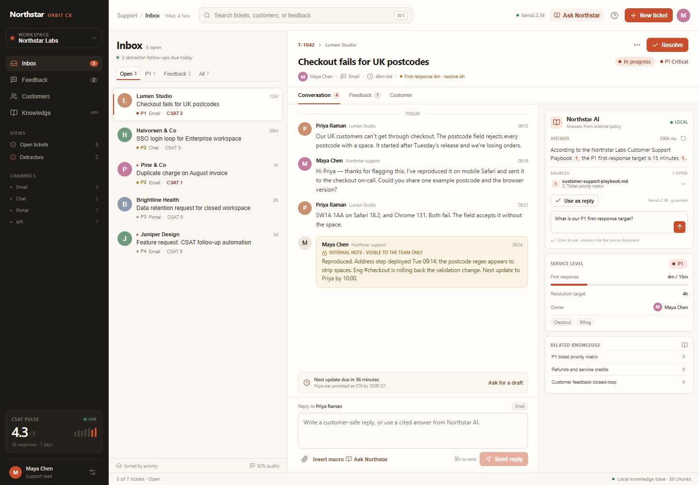
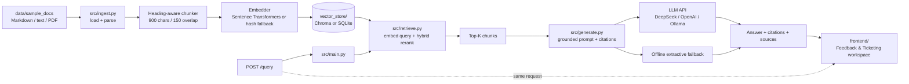

# Northstar Labs — RAG Knowledge Assistant & CX Workspace

A complete, local-first Retrieval-Augmented Generation (RAG) service and a
Customer Feedback & Ticketing frontend. It answers employee questions from a
small internal knowledge base, returns **cited answers plus the retrieved source
text**, and gives support teams a working inbox for tickets, CSAT follow-ups,
and drafting cited replies.

The sample corpus is a fictional company ("Northstar Labs") and includes the
customer-support and ticketing playbook: P1–P4 response targets, escalation,
refunds, and the CSAT closed-loop process. Questions about customer feedback,
ticketing, HR policy, security, expenses, and the Orbit product are all supported.

> **Status:** working end-to-end, fully local. Ollama + `llama3.2:3b` generate
> answers on this machine with no API key and no per-token cost. The API still
> runs with a deterministic offline fallback (hash embeddings + SQLite +
> extractive answers) when no model is available.



---

## Why this project is more than a demo

| Concern | Implementation |
| --- | --- |
| Document ingestion | Markdown-aware heading parser, overlapping windows aligned to natural breaks, PDF support, stable chunk IDs, source/section metadata |
| Embeddings | Local Hugging Face model through Sentence Transformers (`all-MiniLM-L6-v2` by default), with a deterministic offline fallback |
| Vector database | Persistent local ChromaDB collection, with a persistent SQLite + NumPy fallback |
| Retrieval quality | Cosine vector search + explainable lexical reranking (coverage + saturated term frequency) |
| Grounded generation | Numbered context, strict system prompt, temperature 0, citation validation, refusal when context is insufficient |
| Offline mode | Extractive answer built only from query-overlapping sentences, always cited |
| API | FastAPI, Pydantic schemas, `/docs`, health/readiness, re-index endpoint, source listing |
| Frontend | React + Vite Customer Feedback & Ticketing workspace, served by FastAPI at `/app/`; queue, ticket detail, CSAT closed loop, new-ticket flow, and a live cited assistant |
| Observability | Per-request latency, retrieval scores, generation mode, warnings |
| Testing | 20 Python tests plus Playwright interaction checks for search, filters, feedback, resolution, ticket creation, and cited answers |

---

## Architecture



### Request flow

1. The question is embedded with the same model used at ingestion time.
2. The vector store returns up to `RETRIEVAL_CANDIDATES` candidates.
3. Candidates are reranked with a hybrid score: neural/vector similarity plus
   exact-term lexical evidence. Exact terms such as `P1`, `SSO`, `30 days`, and
   `INR 8,000` matter in policy Q&A and can be washed out by embeddings alone.
4. The top `TOP_K` chunks are numbered and inserted into the prompt.
5. The LLM must cite every factual sentence as `[1]`, `[2]`, etc.
6. The API validates citations against the chunks actually supplied, then returns
   the answer, citation details, and full source text with scores and warnings.

---

## Project structure

```text
rag-qa-project/
├── data/
│   └── sample_docs/
│       ├── company-handbook.md
│       ├── customer-support-playbook.md
│       ├── expense-and-travel-policy.md
│       ├── information-security-policy.md
│       └── orbit-product-faq.md
├── docs/
│   └── frontend-preview.png       # UI screenshot used in this README
├── frontend/
│   ├── src/
│   │   ├── components/            # sidebar, queue, workspace, assistant, dialog
│   │   ├── kit/                   # selected Stageshow parts + MIT notice
│   │   ├── App.tsx                # workspace state and interactions
│   │   ├── api.ts                 # /query and /health client
│   │   ├── data.ts                # realistic sample ticket corpus
│   │   └── styles.css             # product UI, responsive rules
│   ├── index.html
│   ├── package.json
│   ├── package-lock.json
│   └── vite.config.ts
├── scripts/
│   └── evaluate.py              # 8-question retrieval/answer smoke evaluation
├── src/
│   ├── __init__.py
│   ├── config.py                # env-driven settings
│   ├── embeddings.py            # Sentence Transformers + hashing fallback
│   ├── generate.py              # prompt, LLM call, citations, offline extractor
│   ├── ingest.py                # parsing, chunking, embedding, persistence
│   ├── main.py                  # FastAPI app + service layer + /app static mount
│   ├── retrieve.py              # query embedding + hybrid reranking
│   └── vector_store.py          # Chroma + SQLite persistence
├── tests/
│   ├── conftest.py
│   ├── test_api.py
│   ├── test_generate.py
│   ├── test_ingest.py
│   └── test_retrieval.py
├── vector_store/
│   └── .gitkeep                 # generated DB artifacts are git-ignored
├── .env.example
├── .gitignore
├── pytest.ini
├── README.md
├── requirements-dev.txt
├── requirements-light.txt
└── requirements.txt
```

Generated artifacts are ignored on purpose; `python -m src.ingest` recreates the
vector store, and `npm run build` recreates `frontend/dist`.

---

## Quick start

### 1. Clone and enter the project

```powershell
git clone <your-repository-url>
cd rag-qa-project
```

If you already have the folder locally, just `cd` into it.

### 2. Create a virtual environment

```powershell
python -m venv .venv
.\.venv\Scripts\Activate.ps1
python -m pip install --upgrade pip
```

macOS/Linux:

```bash
python3 -m venv .venv
source .venv/bin/activate
```

### 3. Install dependencies

Recommended (semantic embeddings + Chroma):

```powershell
pip install -r requirements.txt
```

Lightweight / offline / CI (hashing embeddings + SQLite):

```powershell
pip install -r requirements-light.txt
```

### 4. Configure the LLM

```powershell
Copy-Item .env.example .env
```

Edit `.env` and choose one provider:

```dotenv
# DeepSeek (recommended default for this project)
LLM_PROVIDER=deepseek
DEEPSEEK_API_KEY=sk-...
LLM_MODEL=deepseek-chat
```

```dotenv
# OpenAI
LLM_PROVIDER=openai
OPENAI_API_KEY=sk-...
LLM_MODEL=gpt-4o-mini
```

```dotenv
# Local Ollama (no cloud key, no API cost)
LLM_PROVIDER=ollama
LLM_MODEL=llama3.2:3b
LLM_BASE_URL=http://localhost:11434/v1
```

Start Ollama and pull the model once:

```powershell
ollama serve
ollama pull llama3.2:3b
```

Use `llama3.2:1b` instead if the machine has limited RAM or you want faster CPU
answers. The model runs entirely on your machine; no document text leaves the
host.

With no key, `LLM_PROVIDER=auto` resolves to `offline` and the service uses the
cited extractive fallback. This is useful for a smoke test, but it is not a
substitute for an LLM.

### 5. Build the vector store

```powershell
python -m src.ingest
```

Illustrative output (timings and the exact store path vary by machine):

```text
Ingested 58 chunks from 5 documents in 196.0 ms
Embeddings: sentence-transformers/all-MiniLM-L6-v2 (sentence-transformers) | Store: chroma at .../vector_store/chroma
Start the API with: python -m uvicorn src.main:app --reload
```

The first Sentence Transformers run downloads the model. Chroma writes to
`vector_store/chroma/`; the fallback writes `vector_store/rag-*.sqlite3`.

### 6. Run the API

```powershell
python -m uvicorn src.main:app --reload
```

Open:

- Customer Feedback & Ticketing UI: <http://127.0.0.1:8000/app/> (when
  `frontend/dist` exists)
- API docs: <http://127.0.0.1:8000/docs>
- Health: <http://127.0.0.1:8000/health>
- Root: <http://127.0.0.1:8000/>

### 7. Build and open the UI

The production build is served by FastAPI at `/app/`:

```powershell
cd frontend
npm install
npm run build
cd ..
python -m uvicorn src.main:app --reload
```

Open <http://127.0.0.1:8000/app/>.

For frontend development with hot reload:

```powershell
cd frontend
npm run dev
```

Open <http://127.0.0.1:5173/>. Vite proxies `/query`, `/health`, and `/sources`
to the API on port 8000.

The UI is a real, responsive workspace:

- inbox with search, priority and feedback filters;
- ticket conversation, internal notes, reply composer, resolve/reopen;
- CSAT detractor view with the closed-loop checklist;
- customer account view and recent tickets;
- new-ticket dialog;
- **Northstar AI** panel that calls the live `/query` endpoint, shows citations,
  expands source chunks, and inserts a cleaned draft into the reply box.

The visual language follows the **Stageshow** skill: one accent, quiet warm
neutrals, a full-height product surface, real words on the focal content, and no
generic AI sparkles or purple. The selected Stageshow kit parts (`Avatar`,
`Badge`, tokens) live in `frontend/src/kit/` with their MIT license and notice.

The skill was installed globally for this workspace with:

```powershell
npx skills add benjitaylor/skills --skill stageshow --global
```

### 8. Ask a question

```powershell
$body = @{
  question = "What is the first response time for a P1 ticket?"
  top_k    = 4
} | ConvertTo-Json

Invoke-RestMethod -Uri "http://127.0.0.1:8000/query" `
  -Method Post -ContentType "application/json" -Body $body
```

Or with curl:

```bash
curl -X POST http://127.0.0.1:8000/query \
  -H "Content-Type: application/json" \
  -d '{"question":"How many PTO days do employees get?","top_k":4}'
```

Example (abridged):

```json
{
  "question": "How many PTO days do employees get?",
  "answer": "Eligible employees receive 20 days of paid time off (PTO) per calendar year. [1]",
  "citations": [
    {
      "index": 1,
      "source": "company-handbook.md",
      "title": "Northstar Labs Employee Handbook",
      "section": "Northstar Labs Employee Handbook > 3. Paid time off (PTO)"
    }
  ],
  "sources": [
    {
      "citation": 1,
      "source": "company-handbook.md",
      "section": "Northstar Labs Employee Handbook > 3. Paid time off (PTO)",
      "chunk_index": 3,
      "score": 0.6027,
      "cited": true,
      "text": "Northstar Labs Employee Handbook > 3. Paid time off (PTO)\n\n- Eligible employees receive **20 days..."
    }
  ],
  "model": "deepseek-chat",
  "mode": "llm:deepseek",
  "latency_ms": 1234.5,
  "warnings": []
}
```

---

## API reference

| Method | Path | Purpose |
| --- | --- | --- |
| `GET` | `/` | Service metadata and links |
| `GET` | `/health` | Readiness, chunk/document counts, effective backends |
| `GET` | `/sources` | Indexed source files and chunk counts |
| `POST` | `/query` | Retrieve, generate, and return answer + citations + source texts |
| `POST` | `/ingest` | Re-index from `DATA_DIR`; `{"reset": true}` rebuilds cleanly |
| `GET` | `/docs` | Swagger UI |
| `GET` | `/app/` | Customer Feedback & Ticketing UI (after `npm run build`) |

### `POST /query`

Request body:

```json
{
  "question": "How much can I spend on a hotel in India?",
  "top_k": 4
}
```

`top_k` is optional and clamped to 1–10 at the API boundary.

The response includes:

- `answer` — grounded answer with `[n]` citation markers;
- `citations` — only the citation numbers actually used, with source metadata;
- `sources` — every retrieved chunk, its full text, similarity/lexical scores,
  and `cited: true|false`;
- `mode` — `llm:deepseek`, `llm:openai`, `llm:ollama`,
  `offline-extractive`, `extractive-fallback`, or `no-context`;
- `warnings` — truncation, invalid citations, provider failure, or offline mode.

### `POST /ingest`

```json
{ "reset": true }
```

Returns document count, chunk count, embedding backend/model, vector backend,
store location, elapsed time, and any warnings.

The endpoint is intentionally simple for a local assignment. In a real deployment,
put it behind authentication or disable it outside an admin network.

---

## Configuration

All settings are environment variables; `.env` is loaded automatically. Paths are
resolved relative to the repository root unless absolute.

### LLM

| Variable | Default | Notes |
| --- | --- | --- |
| `LLM_PROVIDER` | `auto` | `auto`, `deepseek`, `openai`, `ollama`, `custom`, `offline` |
| `DEEPSEEK_API_KEY` | — | Auto-selects DeepSeek when `LLM_PROVIDER=auto` |
| `OPENAI_API_KEY` | — | Auto-selects OpenAI when DeepSeek key is absent |
| `LLM_API_KEY` | — | Generic key for `custom` endpoints |
| `LLM_BASE_URL` | provider default | OpenAI-compatible base URL, including `/v1` |
| `LLM_MODEL` | provider default | `deepseek-chat`, `gpt-4o-mini`, or `llama3.2` |
| `LLM_TEMPERATURE` | `0` | Keep low for factual RAG |
| `LLM_MAX_TOKENS` | `700` | Answer length cap |
| `LLM_TIMEOUT_SECONDS` | `60` | HTTP timeout |

Provider base URLs:

- DeepSeek: `https://api.deepseek.com/v1`
- OpenAI: `https://api.openai.com/v1`
- Ollama: `http://localhost:11434/v1`

Any OpenAI-compatible endpoint (vLLM, LiteLLM, OpenRouter, a company gateway)
works with `LLM_PROVIDER=custom`, `LLM_BASE_URL`, `LLM_MODEL`, and `LLM_API_KEY`.

### Embeddings and vector store

| Variable | Default | Notes |
| --- | --- | --- |
| `EMBEDDING_BACKEND` | `auto` | `auto`, `sentence-transformers`, `hash` |
| `EMBEDDING_MODEL` | `sentence-transformers/all-MiniLM-L6-v2` | Any local/HF Sentence Transformers model |
| `VECTOR_BACKEND` | `auto` | `auto`, `chroma`, `sqlite` |
| `COLLECTION_NAME` | `northstar_docs` | Prefix for the persistent collection |
| `CHUNK_SIZE` | `900` | Target characters, including heading prefix |
| `CHUNK_OVERLAP` | `150` | Overlap characters between adjacent windows |
| `TOP_K` | `4` | Chunks passed to generation |
| `RETRIEVAL_CANDIDATES` | `12` | Candidates fetched before reranking |
| `MIN_RETRIEVAL_SCORE` | `0.0` | Optional final-score cutoff |
| `DATA_DIR` | `data/sample_docs` | Input directory |
| `VECTOR_DIR` | `vector_store` | Persistent store directory |
| `LOG_LEVEL` | `INFO` | Python logging level |

`auto` behavior:

- **Embeddings:** use Sentence Transformers if the package is importable;
  otherwise log a warning and use deterministic hashing.
- **Vector store:** use Chroma if importable and initialization succeeds;
  otherwise log a warning and use SQLite.

This makes the project runnable in a locked-down or offline environment without
silently pretending that hash embeddings are neural embeddings.

### Switch to the fully offline stack

```powershell
$env:EMBEDDING_BACKEND = "hash"
$env:VECTOR_BACKEND = "sqlite"
$env:LLM_PROVIDER = "offline"
python -m src.ingest
python -m uvicorn src.main:app --reload
```

Run the evaluation:

```powershell
python scripts/evaluate.py
```

Expected with the sample corpus:

```text
yes   yes        yes   yes   How many PTO days do employees get?
...
8/8 checks passed | mode=llm:ollama
Running fully locally through Ollama; no API key or API cost.
```

With `LLM_PROVIDER=offline`, the same harness reports
`mode=offline-extractive` instead.

---

## Design decisions

### Heading-aware chunking

Splitting by fixed character counts alone loses the section that gives a chunk its
meaning. This project:

1. parses Markdown headings into a stack (e.g. `Handbook > Paid time off`);
2. ignores `#` lines inside fenced code blocks;
3. splits section bodies into overlapping windows, preferring paragraph, sentence,
   then word boundaries;
4. stores `source`, `title`, `heading`, `chunk_index`, `doc_id`, and a content hash
   with every chunk;
5. prepends the full heading path to the chunk so the embedding and the LLM both
   see the section context.

Default chunk size is 900 characters with 150 characters of overlap. That is a
reasonable starting point for policy documents; the evaluation can be rerun after
changing it.

### Why hybrid retrieval?

Vector similarity is good at paraphrase ("time off" vs "vacation"). It is weaker at
exact identifiers and numbers (`P1`, `SAML`, `INR 8,000`, `30 days`). The retriever
therefore combines absolute cosine similarity with a lightweight lexical score
based on query-term coverage and saturated term frequency. For the hashing
fallback, lexical evidence gets 60% of the weight; for a neural embedder, it gets
30%.

This is deliberately explainable: every source in the API response shows
`vector_score`, `lexical_score`, and the combined `score`.

### Hallucination controls

- The system prompt permits **only** the supplied context.
- The model must cite each factual sentence.
- Citations are parsed and checked against the actual number of chunks. Unknown
  citations produce a warning.
- If no context is retrieved, the answer is a refusal, not a guess.
- If no key or a provider error occurs, the offline extractor answers only from
  query-overlapping sentences and cites them.
- An empty vector store returns `409 Conflict` with an instruction to ingest,
  rather than generating an ungrounded answer.

No RAG system can prove grounding, so the API exposes warnings and full source
text so a human can verify the answer. Production systems should add a
cross-encoder reranker, answer-level entailment checks, authentication, and audit
logging.

### Citation format

Answers use `[1]`, `[2]`, or `[1, 2]`, matching the numbered context. The API's
`sources` array is one-based and includes a `cited` boolean, so a UI can highlight
exactly which retrieved passages supported the answer.

### Frontend design

The UI applies the **Stageshow** skill to a real workspace rather than a marketing
mockup:

- a full-height product surface, not a floating window inside a card;
- one warm neutral family and one persimmon accent; status color only for status;
- the selected ticket and the assistant answer are the focal points, while the
  queue and utility rail stay quieter;
- real customer/ticket content replaces placeholder bars; no decorative
  gradients, purple, or AI sparkles;
- the assistant uses a book icon, not a magic wand, and every answer exposes its
  source chunks;
- the 390px layout drops the sidebar and stacks the queue above the ticket rather
  than squeezing the desktop grid.

---

## Sample knowledge base

| File | Topics |
| --- | --- |
| `company-handbook.md` | PTO, sick leave, parental leave, remote work, equipment, learning budget, reviews |
| `customer-support-playbook.md` | P1–P4 SLAs, ticket lifecycle, escalation, refunds, CSAT/feedback loop, privacy, QA |
| `expense-and-travel-policy.md` | approval thresholds, reimbursement, meals, hotels, flights, mileage, corporate cards |
| `information-security-policy.md` | passwords/MFA, devices, VPN, data classification, access, phishing, lost devices, AI tools |
| `orbit-product-faq.md` | plans, trial, SSO/SCIM, integrations, residency/retention, uptime, certifications, rate limits |

All documents are fictional and use `example` domains. Replace them with your own
Markdown, text, or PDF files and rerun ingestion.

### Customer feedback and ticketing coverage

The corpus is designed to answer the customer-feedback/ticketing module questions,
including:

- "What is the first response time for a P1 ticket?"
- "When is a refund eligible, and who approves it?"
- "What happens after a customer gives a 1 or 2 CSAT score?"
- "How long after resolution does a ticket close automatically?"
- "Who reviews customer feedback themes, and how often?"

The support playbook is the source of truth for these answers, and the assistant
returns the exact playbook section as a citation.

---

## Testing

```powershell
pip install -r requirements-dev.txt
python -m pytest
```

The suite uses hashing embeddings and SQLite so it never downloads a model or
calls an external API.

Current result:

```text
20 passed
```

Tests cover:

- Markdown section parsing and code-fence handling;
- chunk metadata, ordering, and overlap;
- persistence and reload of the SQLite store;
- retrieval of PTO and security sections;
- lexical scoring and one-based citation formatting;
- prompt source numbering;
- citation parsing with invalid indices;
- offline extractive answers and refusals;
- API health, query, validation, source listing, ingest, and the empty-store 409.

Browser checks on the built UI cover:

- inbox search and P1/Feedback filters;
- selecting a ticket, opening the feedback view, and closing the loop;
- resolving a ticket and reopening it;
- creating a ticket through the dialog;
- asking the local assistant, receiving a cited answer, and inserting it into the
  reply composer;
- desktop and 390px layouts with no console errors.

### Evaluation

```powershell
python scripts/evaluate.py
python scripts/evaluate.py --json
```

The eight questions cover all five documents and check retrieval hit, key-fact
presence, and citation presence. This is a smoke evaluation, not a benchmark; add
your own question set before changing chunk sizes or embedding models.

---

## Rebuilding and switching backends

Rebuild in place:

```powershell
python -m src.ingest --reset
```

Choose backends explicitly:

```powershell
python -m src.ingest --embedding-backend hash --vector-backend sqlite --reset
```

Artifact names include the embedding backend and model digest, so switching from
hash to Sentence Transformers creates a separate collection/database instead of
mixing incompatible dimensions. Chroma collections also reset cleanly on
`--reset`.

If you change the embedding model, re-ingest. A query embedded with model A cannot
be compared meaningfully with documents embedded with model B.

---

## Troubleshooting

| Symptom | Fix |
| --- | --- |
| `409` on `/query` | The store is empty. Run `python -m src.ingest` or `POST /ingest`. |
| `No API key configured ... offline extractive` | Add `DEEPSEEK_API_KEY` / `OPENAI_API_KEY` or run Ollama. |
| `sentence-transformers is not installed` | `pip install -r requirements.txt`, or use `EMBEDDING_BACKEND=hash`. |
| Model download fails | Check Hugging Face network access/cache, or use the hash fallback. |
| Chroma fails to initialize | Set `VECTOR_BACKEND=sqlite`; the API automatically falls back in `auto` mode. |
| Chroma dimension error | Re-ingest with `--reset` or delete `vector_store/chroma/`. |
| `401`/`403` from the LLM | Check the provider key and base URL. |
| `429` from the LLM | Back off or upgrade quota; the API returns an extractive fallback with a warning. |
| Slow first request | The embedding model is loading/downloading on first use. |
| `/app/` returns 404 | Build the UI: `cd frontend; npm install; npm run build`, then restart the API. |
| UI says **API offline** | Start FastAPI on port 8000 and check `/health`. |
| UI cannot answer | Confirm Ollama is running and `llama3.2:3b` is pulled, then reload the page. |
| Tests cannot create temp folders | Use the included `pytest.ini`; if your sandbox blocks `%TEMP%`, run with a writable `--basetemp`. |

---

## Git workflow

This build is developed on a dedicated feature branch:

```powershell
git branch --show-current
# feature/rag-qa-pipeline
```

Commit progression:

```text
chore: scaffold project, sample corpus, and configuration
feat(ingest): add heading-aware chunking and embedding pipeline
feat(retrieval): add persistent vector store and hybrid search
feat(generate): add grounded prompting, citations, and offline fallback
feat(api): expose FastAPI query and ingestion endpoints
test: cover ingestion, retrieval, generation, and API behavior
docs: document setup, architecture, evaluation, and operations
docs: document the local Ollama setup and evaluation mode
feat(ui): add the Customer Feedback & Ticketing workspace
```

To publish it:

```powershell
git remote add origin <your-repository-url>
git push -u origin feature/rag-qa-pipeline
```

If your team uses a protected `main`, open a pull request from
`feature/rag-qa-pipeline` into `main`. The generated store and `.env` are ignored,
so every clone rebuilds its own local index.

---

## Limitations and production hardening

This is a one-week internal assignment, not a production service:

- The sample corpus is small and fictional.
- The offline extractor is lexical and intentionally conservative; it is a
  fallback, not an answer-quality strategy.
- There is no authentication, rate limiting, or tenant isolation. Put the API
  behind an internal gateway before exposing it.
- There is no cross-encoder reranker, query expansion, or answer entailment model.
- Chroma is single-node and local. For scale, use a managed vector database or a
  dedicated retrieval service.
- The vector store is rebuilt from source documents rather than incrementally
  synchronized on file changes.
- The frontend uses an in-memory sample ticket corpus: new tickets, replies,
  resolutions, and close-loop actions reset on refresh. Wire those mutations to a
  ticket API before using the workspace for real support.
- The frontend is single-page and has no authentication or role-based views.
- LLM usage, token counts, and provider errors are logged, but there is no
  metrics/tracing backend.

Useful next steps: add a cross-encoder reranker, cache embeddings by content hash,
add an incremental ingestion manifest, evaluate with a labelled question set, and
add authentication plus per-user document permissions.

---

## License and content

The source code is provided for the assignment. The knowledge-base documents are
fictional sample content created for this project; replace them before using the
system with real company policy. No real customer data is included.
